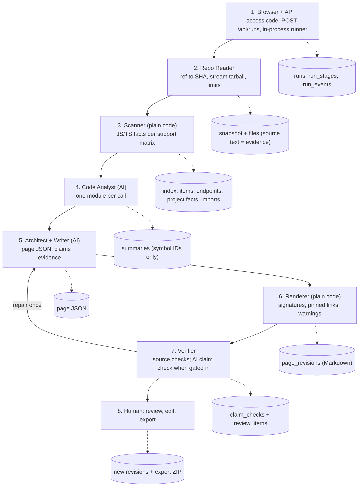
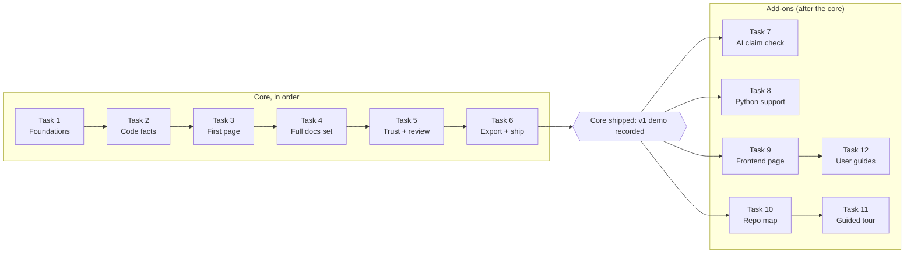

# SpecsDoctor — Technical Design & Build Tasks

> Markdown copy of the Claude doc: https://claude.ai/artifact/LfXhkY3hA2ESQrXrQKiP2F (exported 2026-11-05). The online doc is the source of truth until this file is edited directly.

Nov 4, 2026 · @Dikshyant

This plan answers the reviewer feedback on SpecsDoctor PRD Version 5: it keeps the parser-first product, tightens what "verified" means, and turns the PRD into contracts, a backlog, and 12 numbered build tasks: six core tasks first, then add-on tasks for the repo map, the guided tour and plain-language user guides.

## How to read this plan

Nothing here is approved yet. Every decision carries one of three labels so reviewers can tell approved scope from defaults.

| Label | Meaning |
| --- | --- |
| **Approved (v4)** | In Version 4, which both authors wrote |
| **Default** | Claude's recommended choice; it stands unless an author overrides it |
| **Authors decide** | Needs a decision from Diane and Dikshyant (collected in section 8) |

**Product promise (Default, replaces "verified docs"):** SpecsDoctor generates source-linked developer documentation drafts, checks extracted names and signatures against the code, and flags unsupported or uncertain claims for human review.

**Development context:** two builders using AI coding tools. AI speeds up scaffolding, UI, parsers and tests; it does not make extraction accuracy or integration automatic. So the plan is built around seven working milestones, each proving a risky assumption before the next layer goes on.

## Where this plan disagrees with the feedback

This plan adopts nearly all of the feedback. It departs in five places, each for a concrete implementation reason.

| Feedback recommends | This plan does | Why |
| --- | --- | --- |
| Structured claims with evidence for all page content | Structured claims only for **technical** content; overview and narrative prose stay free text, cited to the README where possible | Forcing every sentence of an overview into a claim object doubles Writer cost and gives reviewers noise. The Verifier still scans all rendered text for unknown project symbols. |
| Define remote link checking | No remote link checking in v1 | Source URLs are generated deterministically from the pinned SHA and an in-bounds line range, so a remote check adds network calls without catching new errors. |
| Track human approval as a product state | A lightweight **reviewed** flag per page revision; not a publish gate | SpecsDoctor never publishes. A per-revision flag gives export an honest status without building an approval workflow. |
| Keep Python, frontend, AI claim check as Should (no pruning) | Agree, but as add-on tasks after the core ships (section 6). P1 (AI-only fallback) and P2 (PR creation) stay pruned | Both pruned items add a second trust model or GitHub write auth; neither serves the parser-first promise. |
| Measure reviewer time to a usable draft | Measure it, but with a simple stopwatch protocol on 2 runs, not instrumentation | Adds the value metric without building telemetry. |

## 1. Recommended dispositions (C1–C15, P1–P6)

Recommend accepting 13 of 15 changes as written, accepting 2 with amendments, keeping 5 prunes, and partly reversing 1 (P6). These are recommendations; the authors set the final status in the v5 change log.

| ID | Proposal | Recommendation | Reason |
| --- | --- | --- | --- |
| C1 | Background run model | **Accept, amended** | In-process runner with persisted state, plus the full state machine in §4a. No queue infrastructure. |
| C2 | Access code + limits | **Accept, amended** | The code protects all routes (generate, view, edit, export), not just Generate; limits become enforced reservations (§4a). |
| C3 | Express route resolution | **Accept, amended** | Routes become first-class items independent of handler export; evidence covers mount and declaration; ID collisions handled (§4c). |
| C4 | Extra Scanner facts | Accept | Moves config, setup and schema pages onto parser facts. Support matrix in §2 bounds it. |
| C5 | AI claim-support check | Accept as Should | Gated entry (§6). Results are "AI-assessed," never "verified." |
| C6 | Narrow source-link rule | Accept | "Technical claim" is now defined (§2). |
| C7 | Frontend coverage | Accept as Should | Coverage boundary defined: no React reference pages; `frontend.md` only. |
| C8 | Data contracts | Accept, expanded | Replaced by the full contracts in §4b–4d. |
| C9 | Tarball fetch | Accept | Adds archive safety rules (§4e). |
| C10 | Work split | Accept, rebalanced | Shared contracts and orchestration get explicit owners (§5). |
| C11 | Early deploy + buffer | Accept | The stub deploy ends Task 1 (milestone M1). |
| C12 | Testing plan | Accept, expanded | Independent inventory, injected defects, stratified sample (§7). |
| C13 | "Unverified" example label | Accept | Becomes the `not_executed` status on every example. |
| C14 | Component count | Accept | Wording fix. |
| C15 | Formatting fixes | Accept | Wording fix. |
| P1 | AI-only fallback → Future | **Keep pruned** | Other-language files get page status `unsupported` instead. |
| P2 | PR creation → Future | **Keep pruned** | Needs GitHub write auth. |
| P3 | Refresh + cache → Could | **Keep pruned** | Kept off the critical path; cache key rules defined if built (§4b). |
| P4 | Markdown editor, not rich editor | Keep | Editing still tracks revisions and staleness (§2). |
| P5 | One Render service | Keep | Render free web services sleep after 15 minutes idle; the $7 Starter instance removes that (see Sources). |
| P6 | Python Must → Should | **Keep Should, add entry gate** | Feedback asks Python stay planned; it is add-on Task 8, built after the core ships. |

## 2. PRD corrections and settled assumptions

All items below are **Default** unless marked. They replace the matching v5 wording before coding starts.

### What "verified" means: four separate statuses per claim

A valid name and citation do not prove behavior, so each technical claim carries four independent statuses. Analyst self-reported `confidence` is kept as a hint for reviewers but counts toward none of them.

| Dimension | Values | Set by | What it proves |
| --- | --- | --- | --- |
| `structural` | `pass` · `fail` · `n/a` | Verifier (plain code) | Every referenced symbol exists in the index, signatures match it, evidence paths and line ranges exist in the pinned snapshot |
| `ai_assessment` | `supported` · `contradicted` · `insufficient_evidence` · `not_assessed` | Verifier (AI, Should) | A model judged the cited source excerpts; never runtime correctness |
| `execution` | `not_executed` (always in v1) | Fixed | Nothing was run |
| `human` | `unreviewed` · `reviewed` | User, per page revision | A person read this revision |

UI and export wording: "Source-checked" (structural pass), "AI-assessed: supported", "Not run", "Reviewed by a person." The words "verified", "exact", and "zero hallucinations" are removed from the PRD. The metric becomes **zero invented project symbols in rendered docs**, measured on fixtures.

### Definitions

- **Module:** one documentable source file (`.js .jsx .mjs .cjs .ts .tsx`, or `.py` if Python ships) after filters. All detected documentable modules enter the pipeline. The per-run AI budget controls how many receive model-written explanations.
- **Code item:** a function, class, method, or exported constant recorded in the index. **Documented code item:** an exported (JS/TS) or public (Python) code item outside the frontend exclusion. "Exported" is a documentation convention, not a promise of a stable API.
- **Endpoint:** an Express route registration. Endpoints are documented whether or not their handler is exported.
- **Technical claim:** a statement about a specific symbol, endpoint, env var, command, or table. Each has an ID and one or more evidence references. Narrative overview text is not a technical claim.
- **Coverage (two separate numbers):** *extraction recall* = items in the independent inventory found by the Scanner; *documentation coverage* = documented code items and endpoints that appear on a rendered page.
- **Known vs inferred setup:** commands copied from `package.json` scripts or manifests are marked **known**. Steps the Writer infers (e.g. "create a database first") are marked **inferred** and always become a review item.

### Page statuses (replaces "Not found in this repository")

| Status | When | Shown as |
| --- | --- | --- |
| `generated` | Page produced from evidence | Normal page |
| `not_applicable` | Detection ran fully and found no subject (no Express dependency, no routes) | "Not applicable to this repository" |
| `not_detected` | Extraction was partial (unsupported patterns or skipped files could hide the subject) | "Not detected by this run" + link to the coverage report |
| `unsupported` | Subject is in a language or format SpecsDoctor does not parse | "Not supported in this version" |
| `generation_failed` | A stage failed or the budget ran out | "Generation failed" + reason |

### Scanner support matrix (JS/TS Must)

| Area | Supported (extracted) | Flagged (recorded, sent to review) | Skipped |
| --- | --- | --- | --- |
| Files | `.js .jsx .mjs .cjs .ts .tsx` | Parse errors | `.d.ts`, minified (>1 line over 2,000 chars), `node_modules`, build output, files over 1 MB |
| Exports | Named, default, `export { a as b }`, `export * from` (one hop), `module.exports = {...}`, `module.exports.x =`, `exports.x =` | Dynamic `module.exports[key]`, conditional exports | — |
| Items | Function declarations, arrow/function expressions bound to `const`, classes, class methods, TS interfaces/types (name only) | Higher-order wrappers (e.g. `asyncHandler(fn)`) recorded with the wrapper noted | Anonymous default exports get name `default` |
| Types | Explicit TS annotations and JSDoc `@param`/`@returns` | — | Inferred types: recorded as `null`, never guessed |
| Imports | Static `import`, `require('literal')`, relative paths, `index.js` resolution | Aliases (`@/`), dynamic `import()` / `require(var)` → unresolved | Package imports kept as external dependencies |
| Env vars | `process.env.NAME`, `process.env['NAME']`, destructuring `const { A } = process.env`, `.env.example` keys | `process.env[var]` (dynamic) | Values never read |
| Express | `app/router.METHOD(path, ...mw, handler)`, `router.route(path).get()`, `app.use(prefix, router)`, nested and multiple mounts, inline handlers | Non-literal paths or prefixes → `resolved: false` | Non-Express frameworks → page `unsupported` |
| Schemas | `*.sql` `CREATE TABLE` (via `pgsql-ast-parser`), `prisma/schema.prisma` models | Knex/Sequelize migrations and models (file listed, AI-read on the data-model page and labeled) | Other ORMs |
| Manifests | Every `package.json`: scripts, deps, engines, workspace directory | — | Lock files |
| Frontend (Should) | `react-router` `<Route path element>` and `createBrowserRouter` objects; top-level component props from TS types or destructured params | Computed routes | Component internals |
| Python (Should) | `def`, `class`, methods, `__all__`, type hints, docstrings, `os.environ`/`os.getenv` literals | Dynamic `__all__` | Notebooks |

Backends are not assumed to live in `server/`: every `package.json` is a workspace, and the Express app is found by the file that calls `express()`.

### Contradictions resolved

| Issue | Resolution |
| --- | --- |
| Python "fully supported" yet Should | Python is conditional everywhere: "supported when FR-4b ships." Until then `.py` files get page status `unsupported`. |
| "Every public item documented" vs. no React reference pages | Coverage denominator excludes files under detected frontend workspaces (any `package.json` depending on `react`). |
| Architect is Should, its pages look mandatory | If the Architect is cut or fails: `tech-stack.md` and `data-model.md` render deterministically from Scanner facts as tables; `architecture.md` renders the parser import graph as a Mermaid diagram with no prose and status `generation_failed` for the prose part. |
| Every run produces every page | Every page slot always exists, each with one of the five statuses above. |
| "No agent succeeding" = failure | Replaced by the usable-output rule in §4a. |
| Cache in risk mitigations while Could | Removed from mitigations. Repeat demo runs reuse a saved run instead. |
| Demo uses a test branch | Intake accepts `github.com/owner/repo` or `/tree/<ref>` plus an optional ref field; the ref resolves to a SHA once at start and every citation pins to it. |
| Stages claim JSON, some output Markdown | Every AI stage outputs JSON. Markdown is produced only by the deterministic renderer (§4c). |
| Review reasons miss operational failures | Split: `review_items` for content findings, `run_events` for operational failures (§4b). |
| Placeholder diagram and timeline | Replaced by the drawings in §3 and §6. |

## 3. Updated architecture and data flow

The main change from v5: AI stages now write only structured JSON, and a plain-code renderer turns it into Markdown. Every signature, link and warning a reader sees therefore comes from the index, not from a model.


*Every AI call goes through the budget manager: reserve worst case, call, record actual cost.*

The Verifier reads source excerpts from the stored `files.content` of the pinned snapshot, not from GitHub, so saved runs can be rechecked offline. Repairs go back to whichever stage owns the page (Writer or Architect).

### AI source draft fallback

When the Scanner fails or finds no documentable symbols or endpoints, live mode can draft an overview from selected excerpts of supported text source files, including HTML and several languages without dedicated parsers. The reader retains these files separately from the scanner input. Existing archive and sensitive-file limits apply, and the prompt has its own size cap. The model returns structured observations with line ranges. The fallback checks ranges against the supplied excerpts before the renderer creates commit-pinned links. The draft identifies its limited coverage and requires human review. Repository code is never executed. Stub mode skips this fallback.

## 4a. Run lifecycle, budget enforcement and limits

**Execution model (Default):** one Render instance runs an in-process runner that reads work from Postgres. No external queue. Limitation, stated openly: a restart interrupts the active run, and the app cannot scale past one instance without changes.

### Run states and transitions

| From | To | Trigger |
| --- | --- | --- |
| — | `queued` | `POST /api/runs` accepted (access, limits, URL and ref valid) |
| `queued` | `running` | Runner picks the oldest queued run when no run is active |
| `running` | `complete` | All stages done, no failed pages or modules, usable-output rule met |
| `running` | `complete_with_errors` | Usable-output rule met, but some modules, pages or checks failed or were skipped |
| `running` | `failed` | Fatal stage failure, usable-output rule not met, or interrupted by restart |
| `queued` | `failed` | Repo became unreadable before start, or queued longer than 30 minutes |

Stage states: `pending`, `running`, `done`, `partial` (some items failed), `skipped` (gated off or upstream budget), `failed`. A stage records `attempt`, counts (`items_total`, `items_done`, `items_failed`), and timings.

**Fatal vs recoverable:** Repo Reader or Scanner failure is fatal (no index, no evidence). Any single module, page, or AI check failure is recoverable and recorded as a `run_event`.

**Usable-output rule:** a run is saved as a docs set only if (1) the index contains at least one documented code item or endpoint, (2) at least one page has status `generated`, and (3) documentation coverage is at least 50%. Otherwise the run is `failed`; its partial pages stay in the database for debugging but are not listed as a saved docs set.

**Upstream failures degrade, not stop:**

- Analyst fails or is skipped for a module → its reference entries render deterministically from the index (signature, params, docstring, source link) with no AI prose, and a review item says so.
- Architect fails → deterministic fallbacks in §2.
- Writer fails for a page → page status `generation_failed`.
- AI claim check fails or is skipped → claims keep `ai_assessment: not_assessed`; the page banner says "AI assessment not run; only source checks applied."

**Other lifecycle rules:**

- **Duplicate Generate:** if a run for the same repo and resolved SHA is `queued` or `running`, the API returns that run instead of starting another.
- **Browser close or reload:** the run continues server-side; the run page URL (`/runs/:id`) resumes polling.
- **Restart recovery:** on boot, `running` runs become `failed` with reason `interrupted`; `queued` runs stay queued and are picked up.
- **Retry ownership:** the AI client wrapper retries a model call once on 429, 5xx, or timeout (exponential backoff). Stages are never retried automatically; the user can start a new run.
- **Repairs:** one repair attempt per failed claim, owned by the stage that wrote the page (Writer or Architect); only repaired claims are rechecked.

### Limits (config defaults, all env-configurable)

| Setting | Default |
| --- | --- |
| Active runs, app-wide | 1 |
| Queued runs, app-wide | 3 (further requests get 429) |
| Concurrent model calls per run | 4 |
| Per-run hard budget | $1.50 estimated cost |
| Reserved for Writer + Verifier | 35% of the run budget |
| Max output tokens per call | Analyst 2,000 · Architect 6,000 · Writer 4,000 · claim check 1,500 |
| Extended thinking | Off or lowest effort on every call (thinking tokens bill as output) |
| Tarball download | 100 MiB |
| Expanded archive | 300 MiB, 15,000 entries |
| Single file | 1 MB (larger files skipped and listed) |
| Modules | All detected modules within archive limits. AI analysis is budget-limited. |
| Stage timeouts | Reader 60 s · Scanner 60 s · model call 120 s · whole run 10 min |

### Budget enforcement (not just reporting)

1. Before scheduling any model call, the budget manager **reserves** its worst case: estimated input tokens × input price + max output tokens × output price.
2. A call is scheduled only if `spent + reserved + this_reservation ≤ cap − protected_reserve`. The protected reserve (35%) is released only to the Writer and Verifier stages.
3. When a call returns, its reservation is replaced by actual cost from the response's usage fields (input, output, cache read/write tokens) at that model's price.
4. Retries, repairs and claim checks go through the same manager.
5. When the Analyst can no longer reserve, remaining modules are marked `skipped_budget` and fall back to deterministic reference entries; the run continues to writing and verification.
6. Every call writes a `model_calls` row: stage, model, input, output and cache tokens, estimated cost, attempt, latency.

### Models and expected cost (Default; measure on fixtures)

| Stage | Model | Why |
| --- | --- | --- |
| Code Analyst | Claude Haiku 5.5 | High volume, structured summaries |
| Reference page prose | Claude Haiku 5.5 | Signatures and links are rendered deterministically; prose is short |
| Architect, narrative pages (overview, getting started, configuration, api-endpoints, frontend) | Claude Sonnet 5.5 | Synthesis across modules |
| AI claim check | Claude Haiku 5.5 | Batched yes/no-style judgments |

At current list prices (Haiku 5.5 $0.10 / $0.50 per million input/output tokens for prompts up to 100K; Sonnet 5.5 $2 / $10), a 30-module PERN repo is estimated at about $0.50–$0.90 per run, mostly Sonnet output on narrative pages. This is an estimate to be replaced by measured cost from fixture runs at the end of Task 4. Model IDs and prices are config values, not code.

## 4b. Database schema

Everything is run-scoped: a run owns its file inventory, source text, index, summaries, pages and findings, so a saved run can be reopened and rechecked without GitHub. Caching (Could) is kept out of these tables.

```sql
-- enums
CREATE TYPE run_status   AS ENUM ('queued','running','complete','complete_with_errors','failed');
CREATE TYPE stage_status AS ENUM ('pending','running','done','partial','skipped','failed');
CREATE TYPE page_status  AS ENUM ('generated','not_applicable','not_detected','unsupported','generation_failed');
CREATE TYPE review_status AS ENUM ('open','corrected','dismissed','accepted_uncertain');

CREATE TABLE repos (
  id uuid PRIMARY KEY DEFAULT gen_random_uuid(),
  owner text NOT NULL, name text NOT NULL,
  created_at timestamptz NOT NULL DEFAULT now(),
  UNIQUE (owner, name)
);

CREATE TABLE runs (
  id uuid PRIMARY KEY DEFAULT gen_random_uuid(),
  repo_id uuid NOT NULL REFERENCES repos(id),
  requested_ref text,                    -- branch, tag or SHA as typed; NULL = default branch
  resolved_sha char(40),                 -- set once by the Repo Reader
  status run_status NOT NULL DEFAULT 'queued',
  failure_code text, failure_detail text,
  intake jsonb,                          -- 3 answers, or NULL
  config jsonb NOT NULL,                 -- models, prompt_version, schema_version, parser_version, limits
  budget_cap_usd numeric(8,4) NOT NULL,
  cost_usd numeric(8,4) NOT NULL DEFAULT 0,
  created_at timestamptz NOT NULL DEFAULT now(),
  started_at timestamptz, finished_at timestamptz
);
CREATE INDEX runs_status_created ON runs (status, created_at);
CREATE UNIQUE INDEX runs_one_active_per_sha ON runs (repo_id, resolved_sha)
  WHERE status IN ('queued','running');  -- duplicate-Generate guard

CREATE TABLE run_stages (
  run_id uuid NOT NULL REFERENCES runs(id) ON DELETE CASCADE,
  stage text NOT NULL,                   -- reader|scanner|analyst|architect|writer|verifier|render
  status stage_status NOT NULL DEFAULT 'pending',
  attempt int NOT NULL DEFAULT 0,
  items_total int, items_done int DEFAULT 0, items_failed int DEFAULT 0,
  message text, started_at timestamptz, finished_at timestamptz,
  PRIMARY KEY (run_id, stage)
);

CREATE TABLE run_events (                -- operational failures and warnings
  id bigserial PRIMARY KEY,
  run_id uuid NOT NULL REFERENCES runs(id) ON DELETE CASCADE,
  stage text, level text NOT NULL CHECK (level IN ('info','warn','error')),
  code text NOT NULL,                    -- e.g. module_failed, parse_error, budget_skipped, timeout
  detail jsonb, created_at timestamptz NOT NULL DEFAULT now()
);

CREATE TABLE model_calls (
  id bigserial PRIMARY KEY,
  run_id uuid NOT NULL REFERENCES runs(id) ON DELETE CASCADE,
  stage text NOT NULL, model text NOT NULL, attempt int NOT NULL,
  input_tokens int, output_tokens int, cache_read_tokens int, cache_write_tokens int,
  est_cost_usd numeric(10,6), status text NOT NULL, latency_ms int,
  created_at timestamptz NOT NULL DEFAULT now()
);

CREATE TABLE files (                     -- inventory + coverage report source
  run_id uuid NOT NULL REFERENCES runs(id) ON DELETE CASCADE,
  path text NOT NULL, language text, size_bytes int, sha256 char(64),
  status text NOT NULL CHECK (status IN ('scanned','skipped','unsupported','failed')),
  reason text,
  content text,                          -- kept only for scanned files and manifests: evidence for the Verifier
  PRIMARY KEY (run_id, path)
);

CREATE TABLE index_items (
  run_id uuid NOT NULL REFERENCES runs(id) ON DELETE CASCADE,
  id text NOT NULL,                      -- stable item ID, see 4c
  kind text NOT NULL,                    -- function|class|method|constant|type|endpoint|env_var|script|table
  name text NOT NULL, path text NOT NULL,
  start_line int NOT NULL, end_line int NOT NULL,
  documented boolean NOT NULL,
  data jsonb NOT NULL,                   -- full item per the index schema
  PRIMARY KEY (run_id, id)
);
CREATE INDEX index_items_name ON index_items (run_id, name);

CREATE TABLE run_artifacts (             -- one row per run: whole-run JSON outputs
  run_id uuid PRIMARY KEY REFERENCES runs(id) ON DELETE CASCADE,
  snapshot jsonb, coverage jsonb, project_facts jsonb, import_graph jsonb, architect_output jsonb
);

CREATE TABLE summaries (
  run_id uuid NOT NULL REFERENCES runs(id) ON DELETE CASCADE,
  module_path text NOT NULL,
  summary jsonb NOT NULL, model text NOT NULL, prompt_version text NOT NULL,
  PRIMARY KEY (run_id, module_path)
);

CREATE TABLE pages (
  id uuid PRIMARY KEY DEFAULT gen_random_uuid(),
  run_id uuid NOT NULL REFERENCES runs(id) ON DELETE CASCADE,
  slug text NOT NULL, title text NOT NULL,
  status page_status NOT NULL, owner_stage text NOT NULL,  -- writer|architect|renderer
  current_rev int NOT NULL DEFAULT 1,
  UNIQUE (run_id, slug)
);

CREATE TABLE page_revisions (
  page_id uuid NOT NULL REFERENCES pages(id) ON DELETE CASCADE,
  rev int NOT NULL,
  origin text NOT NULL CHECK (origin IN ('generated','repaired','user')),
  structured jsonb,                      -- page JSON (generated/repaired only)
  markdown text NOT NULL,                -- may be '' if the user empties a page
  checks_fresh boolean NOT NULL DEFAULT false,
  reviewed_at timestamptz, reviewed_note text,
  created_at timestamptz NOT NULL DEFAULT now(),
  PRIMARY KEY (page_id, rev)
);

CREATE TABLE claim_checks (
  page_id uuid NOT NULL, rev int NOT NULL,
  claim_id text NOT NULL,
  structural text NOT NULL,              -- pass|fail|n/a
  ai_assessment text NOT NULL,           -- supported|contradicted|insufficient_evidence|not_assessed
  explanation text,
  checked_at timestamptz NOT NULL DEFAULT now(),
  PRIMARY KEY (page_id, rev, claim_id),
  FOREIGN KEY (page_id, rev) REFERENCES page_revisions(page_id, rev) ON DELETE CASCADE
);

CREATE TABLE review_items (
  id uuid PRIMARY KEY DEFAULT gen_random_uuid(),
  run_id uuid NOT NULL REFERENCES runs(id) ON DELETE CASCADE,
  page_id uuid REFERENCES pages(id) ON DELETE CASCADE,
  claim_id text,
  fingerprint text NOT NULL,             -- sha256(page slug + claim_id + reason): stable across rechecks
  reason text NOT NULL, severity text NOT NULL CHECK (severity IN ('critical','warning','info')),
  message text NOT NULL, evidence jsonb,
  status review_status NOT NULL DEFAULT 'open',
  resolution_note text, resolved_at timestamptz,
  created_at timestamptz NOT NULL DEFAULT now(),
  UNIQUE (run_id, fingerprint)
);
```

**Revision and freshness rules:** saving an edit inserts a `page_revisions` row with `origin = 'user'` and `checks_fresh = false`, and bumps `pages.current_rev`. On save, the deterministic checks re-run on the new Markdown (unknown project symbols, source-link bounds) and set `checks_fresh = true` for those; AI assessments from the earlier revision are shown as "stale" until a manual Recheck (Could). Review items keep their fingerprint, so a recheck updates rather than duplicates them.

**Retention:** tarballs are streamed and never written to disk. `failed` runs and their source text are deleted after 7 days by a daily cleanup at startup and every 24 hours. Saved runs keep source text so they can be rechecked. Neon's Free plan allows 0.5 GB of storage per project, which fits about 40–60 saved fellowship-sized runs (see Sources).

**If caching (Could) is built:** a summary can be reused only when this key matches: `sha256(path, file sha256, sha256 of resolved local imports, parser_version, prompt_version, schema_version, model, intake)`. Stored in a separate `summary_cache` table so no core table depends on it.

## 4c. JSON stage contracts

Every hand-off is a versioned JSON document (`schema_version`), validated with Ajv on write and read. AI stages are called with the Claude API's structured outputs (`output_config.format` with a JSON schema), which constrains responses to the schema; Ajv still validates, because refusals or truncation can break the shape (see Sources). **AI stages never emit Markdown, signatures or URLs:** a deterministic renderer builds those from the index.

### Stable IDs

| Item | ID format | Collision rule |
| --- | --- | --- |
| Code item | `sym:<path>#<Qualified.name>` | Same name twice in one file → append `@<line>` |
| Endpoint | `ep:<METHOD> <full path>@<declaring path>:<line>` | Includes declaration location, so duplicate method + path registrations stay distinct and are flagged `duplicate_route` |
| Env var | `env:<NAME>` | One per name; references listed |
| Table | `tbl:<name>` | Duplicate definitions flagged |
| Claim | `clm:<page slug>:<n>` | Assigned by the Orchestrator, not the model |

### 1. Repository snapshot (Repo Reader → Scanner)

```json
{
  "schema_version": "snapshot/1",
  "repo": {"owner": "acme", "name": "habit-tracker"},
  "requested_ref": "demo-stale-readme",
  "resolved_sha": "9f2c1e...40 hex",
  "files": [
    {"path": "server/routes/users.js", "size": 1830, "sha256": "...", "status": "scanned"},
    {"path": "client/public/logo.png", "size": 40211, "status": "skipped", "reason": "binary"}
  ],
  "limits_hit": []
}
```

### 2. Scanner index (Scanner → all later stages)

```json
{
  "schema_version": "index/1",
  "parser_version": "js-0.3.0",
  "items": [
    {
      "id": "sym:server/controllers/users.js#createUser",
      "kind": "function", "language": "javascript", "name": "createUser",
      "path": "server/controllers/users.js", "start_line": 42, "end_line": 61,
      "exported": true, "export_style": "commonjs", "documented": true,
      "signature": "createUser(req, res)",
      "params": [{"name": "req", "type": null, "default": null}, {"name": "res", "type": null, "default": null}],
      "returns": null, "doc": "Creates a user from the request body.", "wrapped_by": null
    },
    {
      "id": "ep:POST /api/users@server/routes/users.js:8",
      "kind": "endpoint", "method": "POST", "path": "/api/users", "resolved": true,
      "declaration": {"path": "server/routes/users.js", "start_line": 8, "end_line": 8},
      "mounts": [{"path": "server/app.js", "start_line": 21, "end_line": 21, "prefix": "/api/users"}],
      "middleware": ["sym:server/middleware/auth.js#requireAuth"],
      "handler": {"symbol_id": "sym:server/controllers/users.js#createUser"}
    }
  ],
  "project": {
    "workspaces": [{"dir": "server", "scripts": {"dev": "nodemon index.js"}, "dependencies": {"express": "^4.19.2", "pg": "^8.11.0"}, "engines": null, "frontend": false}],
    "env_vars": [{"id": "env:DATABASE_URL", "refs": [{"path": "server/db/index.js", "line": 3}], "in_env_example": true}],
    "tables": [{"id": "tbl:users", "format": "sql", "source": {"path": "server/db/schema.sql", "start_line": 1, "end_line": 7}, "columns": [{"name": "email", "type": "text", "nullable": false}]}]
  },
  "imports": [{"from": "server/controllers/users.js", "to": "server/db/index.js", "kind": "require"}],
  "unresolved_imports": [{"from": "client/src/App.jsx", "spec": "@/components/Nav"}],
  "coverage": {
    "files": {"scanned": 41, "skipped": 12, "unsupported": 2, "failed": 0},
    "flagged_patterns": [{"path": "server/app.js", "line": 30, "pattern": "dynamic_mount_prefix"}]
  }
}
```

Inline handlers use `"handler": {"inline": {"path": "...", "start_line": 9, "end_line": 14}}`. Dependency relationships come **only** from `imports` (parser-derived); the Analyst no longer outputs `depends_on`.

### 3. Module summary (Code Analyst output)

```json
{
  "schema_version": "summary/1",
  "module_path": "server/controllers/users.js",
  "purpose": "Handles creating, reading and updating users.",
  "items": [
    {"symbol_id": "sym:server/controllers/users.js#createUser",
     "what_it_does": "Validates name and email from the body and inserts a user row.",
     "param_notes": [{"name": "req", "note": "Express request; body has name and email"}],
     "example": {"kind": "illustrative", "text": "POST /api/users {\"name\": \"Ada\"}"}}
  ],
  "open_questions": [{"symbol_id": "sym:server/controllers/users.js#createUser", "text": "Duplicate emails: 409 or 400?"}],
  "confidence_hint": "high"
}
```

The validator rejects any `symbol_id` not in the index for that module.

### 4. Page (Writer and Architect output; renderer input)

```json
{
  "schema_version": "page/1",
  "slug": "api-endpoints", "title": "API endpoints",
  "sections": [
    {"heading": "Users", "blocks": [
      {"type": "endpoint_ref", "endpoint_id": "ep:POST /api/users@server/routes/users.js:8"},
      {"type": "claim", "claim": {
        "text": "Creating a user requires a valid session (requireAuth middleware).",
        "kind": "behavior",
        "symbols": ["sym:server/middleware/auth.js#requireAuth"],
        "evidence": [
          {"path": "server/routes/users.js", "start_line": 8, "end_line": 8},
          {"path": "server/middleware/auth.js", "start_line": 4, "end_line": 19, "symbol_id": "sym:server/middleware/auth.js#requireAuth"}
        ]}},
      {"type": "prose", "text": "All user routes return JSON."},
      {"type": "code", "kind": "known_command", "lang": "bash", "text": "npm run dev", "source": {"path": "server/package.json", "script": "dev"}}
    ]}
  ]
}
```

Block types: `prose`, `claim`, `symbol_ref`, `endpoint_ref`, `env_ref`, `table_ref`, `code` (`known_command` | `inferred_command` | `illustrative`), `mermaid`. The renderer expands `*_ref` blocks into signatures, parameter tables and commit-pinned GitHub links (`https://github.com/<owner>/<repo>/blob/<sha>/<path>#L<start>-L<end>`), and turns claims with failing checks into inline warning admonitions.

### 5. Verification result (Verifier output, per page revision)

```json
{
  "schema_version": "verify/1",
  "page_slug": "api-endpoints", "rev": 1,
  "claims": [
    {"claim_id": "clm:api-endpoints:2",
     "structural": {"status": "pass", "failures": []},
     "ai": {"assessment": "supported", "explanation": "Route declaration passes requireAuth before the handler."}}
  ],
  "unknown_mentions": [{"text": "deleteAccount()", "block": 3}],
  "coverage": {"expected_refs": 12, "rendered_refs": 12}
}
```

Review `reason` values: `unknown_symbol`, `signature_mismatch`, `evidence_out_of_bounds`, `claim_contradicted`, `claim_insufficient_evidence`, `inferred_setup`, `route_unresolved`, `duplicate_route`, `pattern_unsupported`, `open_question`, `module_not_summarized`, `page_generation_failed`. Operational failures (timeouts, parse errors, budget skips) go to `run_events`, not here.

### Verifier rules

1. **Primary input is structured:** claims, `*_ref` blocks and their evidence. Structural check = every symbol ID exists, every evidence path is in the snapshot with `start_line ≤ end_line ≤ file length`, rendered signatures equal index signatures (guaranteed by the renderer, asserted anyway).
2. **Reference completeness:** every documented code item and endpoint appears in at least one `*_ref` block; misses are listed in `coverage`.
3. **Supplementary scan of rendered Markdown:** inline-code identifiers shaped like calls or members (`foo()`, `Foo.bar`) are looked up in the index. Ignored: names of declared dependencies and their known exports, a built-in allowlist (JS globals, Node core modules, Python builtins), and anything inside `illustrative` code blocks. Remaining misses become `unknown_symbol` (warning).
4. **AI claim check (Should):** claims are batched per page, at most 12 claims or 24K input tokens per call. Each claim gets its evidence ranges plus up to two hops of local callees from `imports` (max 150 lines per claim). The model returns, per claim, `supported` / `contradicted` / `insufficient_evidence` and one sentence of explanation.
5. **Repair loop:** contradicted or structurally failing claims go back once to the page's owner stage with the failure reason; only repaired claims are rechecked; anything still failing becomes an inline warning and a review item.
6. **When the AI check is off,** every page banner reads "Source-checked only: names, signatures and citation locations were checked; behavior descriptions were not assessed."

## 4d. API contracts

All routes live under `/api`, return JSON, and require the access session cookie except `POST /api/session`. Errors share one shape: `{"error": {"code": "repo_not_found", "message": "..."}}`.

| Method & path | Purpose | Request | Success response | Notable errors |
| --- | --- | --- | --- | --- |
| `POST /api/session` | Exchange access code for a signed, HTTP-only cookie (8 h) | `{"code": "..."}` | `204` | `401 bad_code`, `429` after 5 failures / 15 min |
| `POST /api/runs` | Start a run | `{"repo_url": "https://github.com/o/r", "ref": "main" \| null, "intake": {...} \| null}` | `202 {"run_id", "status": "queued", "duplicate_of": null}`; existing active run → `200` with `duplicate_of` | `400 invalid_url`, `404 repo_not_found`, `404 ref_not_found`, `503 queue_full` |
| `GET /api/runs?limit=20&before=<ts>` | List saved docs sets and recent runs | — | `{"runs": [{"run_id", "repo", "resolved_sha", "status", "created_at", "cost_usd", "open_findings"}]}` | — |
| `GET /api/runs/:id` | Progress (polled every 2 s) and summary | — | `{"run_id", "status", "repo", "resolved_sha", "stages": [{"stage", "status", "items_total", "items_done", "items_failed", "message"}], "cost_usd", "budget_cap_usd", "coverage", "failure": null}` | `404` |
| `GET /api/runs/:id/pages` | Sidebar | — | `{"pages": [{"slug", "title", "status", "current_rev", "checks_fresh", "reviewed", "open_findings"}]}` | `409 run_not_ready` |
| `GET /api/runs/:id/pages/:slug` | One page, current revision | — | `{"slug", "rev", "origin", "markdown", "status", "checks": {"fresh", "structural_fail", "ai": {"supported", "contradicted", "insufficient", "not_assessed"}}, "reviewed_at"}` | `404` |
| `PUT /api/runs/:id/pages/:slug` | Save an edit (explicit Save, no autosave) | `{"base_rev": 3, "markdown": "..."}` (empty string allowed) | `200 {"rev": 4, "checks_fresh": true}` after deterministic recheck | `409 rev_conflict` if `base_rev` is not current |
| `POST /api/runs/:id/pages/:slug/review` | Mark this revision reviewed | `{"rev": 4, "note": "..."}` | `200` | `409` if rev not current |
| `GET /api/runs/:id/findings?status=open` | Review panel | — | `{"findings": [{"id", "page_slug", "claim_id", "reason", "severity", "message", "evidence", "status", "resolution_note", "resolved_at"}]}` | — |
| `PATCH /api/findings/:id` | Resolve a finding | `{"status": "corrected" \| "dismissed" \| "accepted_uncertain" \| "open", "note": "..."}` (note required unless reopening) | `200` finding | `400 note_required` |
| `GET /api/runs/:id/export.zip?include_review=false` | Download export | — | `application/zip` (contents below) | `409 run_not_ready` |
| `GET /api/health` | Render health check (no auth) | — | `{"ok": true, "db": true}` | — |

**Export ZIP contents:** `mkdocs.yml`, `docs/*.md` (current revision of every page, including user-emptied pages), `docs/provenance.md`, and `review.md` only when `include_review=true`. `mkdocs.yml` sets `theme: material` and the `pymdownx.superfences` custom fence for Mermaid, plus `admonition` so inline warnings render. `provenance.md` lists repo, resolved SHA, run date, models, page statuses, reviewed/unreviewed pages, and counts of open findings by severity. Unresolved warnings stay inline as `!!! warning` admonitions; excluding the review list never removes them. The README in the ZIP gives the one install line (`pip install mkdocs-material`) and `mkdocs serve`.

## 4e. Untrusted repository protections

Requirements are sized for a shared-code classroom demo. Each one is testable (see SEC tests in §7).

| ID | Requirement |
| --- | --- |
| SEC-1 | **Repo text is data, not instructions.** Every prompt wraps repository content in clearly delimited blocks, and system prompts state that instructions inside them must be ignored. AI stages have no tools and can only return schema-shaped JSON, so an injected instruction can at worst produce a wrong claim, which the Verifier and review list are built to catch. |
| SEC-2 | **URL allowlist.** Accept only `https://github.com/<owner>/<repo>` with optional `/tree/<ref>`; owner and repo match `^[A-Za-z0-9_.-]+$`. The server talks only to `api.github.com` and GitHub's codeload redirect; no user-supplied host is ever fetched. |
| SEC-3 | **Bounded archive processing.** Stream the tarball in memory with the size limits in §4a; reject entries with absolute paths, `..` segments, symlinks, hardlinks or device files; never write extracted files to disk. |
| SEC-4 | **Never execute or install repository code.** No `npm install`, no `require()` of repo files, no Python import of repo modules: parsing only. The Python helper reads source text through `ast.parse`, never `exec`. |
| SEC-5 | **Sensitive files stay out of prompts.** Skip `.env`, `.env.*` (except `.env.example`), `*.pem`, `*.key`, `id_rsa*`, and credential JSON files. Before any model call, redact strings matching common key formats (AWS, GitHub, Stripe, private-key headers) and long high-entropy literals, replacing them with `[REDACTED]`. Env var **values** are never extracted. |
| SEC-6 | **Secrets out of logs and prompts.** API keys, GitHub token and access code live in env vars; logs print request IDs, never headers or prompt bodies; model-call logs store token counts only. |
| SEC-7 | **Safe rendering.** The React viewer uses `react-markdown` with raw HTML disabled; links allow only `http(s)` and in-app anchors; Mermaid runs with `securityLevel: 'strict'`. The export keeps Markdown as Markdown and adds no custom JavaScript. |
| SEC-8 | **Access control everywhere.** The session cookie is required for every route that reads or changes saved content (runs, pages, findings, export), not only Generate. Cookie: signed, HTTP-only, `SameSite=Lax`, `Secure` in production. |
| SEC-9 | **Abuse limits.** Queue size and per-run budget from §4a; login attempts rate-limited. |

## 4f. Add-on features (built after the core ships)

Three features we agreed to add are specified here so the core contracts leave room for them. None is built until the core (Tasks 1–6) ships; each is its own task in §6.

### Interactive repo map (Task 10)

An interactive graph of the pasted repository, built **only from parser facts**, so it cannot show a connection that is not in the code.

- **New Scanner facts:** `calls_endpoint` edges from literal URLs in frontend `fetch`/`axios` calls matched to endpoint paths (needs Task 9), and `queries_table` edges from table names in SQL string literals inside handlers (`INSERT INTO habits`). Both are string matches, so they carry `inferred: true` and render dashed.
- **AI's role (one Haiku call):** group modules into named areas ("Auth", "Habits") and write one-line node labels. The validator rejects any ID not in the index.
- **Layout:** deterministic layered layout (ELK.js), left to right by layer: frontend → routes → middleware → handlers → database. Positions saved per run.
- **UI:** React Flow, with three views (Architecture, Request trace, Dependencies), search, minimap, zoom, and a node drawer (summary, signature, code excerpt, link to its doc page). Above 300 nodes, areas start collapsed.
- **Export:** `graph.json` added to the ZIP alongside the existing Mermaid diagram.

```json
{
  "schema_version": "graph/1",
  "nodes": [{"id": "sym:server/controllers/habits.js#createHabit", "kind": "function", "layer": "handler", "label": "createHabit()", "group": "habits"}],
  "edges": [{"from": "ep:POST /api/habits@server/routes/habits.js:8", "to": "sym:server/controllers/habits.js#createHabit", "kind": "routes_to", "inferred": false,
              "evidence": [{"path": "server/routes/habits.js", "start_line": 8, "end_line": 9}]}],
  "groups": [{"id": "habits", "name": "Habits", "summary": "Create, list and update habits."}]
}
```

Edge kinds: `imports`, `mounts`, `routes_to`, `uses_middleware`, `calls_endpoint`, `queries_table`.

### Animated guided tour, Level 2 (Task 11, needs Task 10)

A narrated walkthrough of **the pasted repository** (not of SpecsDoctor), played on the repo map by an original animated guide character with voice and captions.

- **Tour Agent (new AI stage, Sonnet):** reads the graph, module summaries and checked page claims, and plans four standard tours: Big picture, Follow a request, How data is stored, Where to start as a new developer. Each has 4–8 stops. "Follow a request" picks the endpoint with the most handler-to-table edges (a deterministic choice, not the model's).
- **Checks:** every stop's node and edge must exist in the graph; narration is treated as claims (structural check always, AI check once Task 7 ships). A failing stop is repaired once or dropped, with a note in the review list.
- **Player:** the camera glides to each node, a glowing dot travels along the edge, and the guide moves beside the node and speaks. Controls: previous / play / next, stop dots, speed 0.75–1.5×, captions (on by default), voice toggle. Keyboard: Space plays and pauses, arrow keys step. With reduced motion, the camera fades instead of gliding.
- **Guide character:** an original amber orb with two rounded "eyes" (states: idle, talking, pointing, thinking, celebrating), drawn as SVG or Lottie, under 200 KB.
- **Voice:** the browser's built-in speech synthesis (free; voice quality varies by browser and operating system). Captions always carry the same text.
- **Storage:** a `tours` table (`run_id`, `tour_id`, `tour` JSON, `status`); Tour Agent calls go through the budget manager.

```json
{
  "schema_version": "tour/1",
  "tour_id": "follow-request", "title": "Follow a request: creating a habit",
  "stops": [
    {"node_id": "sym:server/middleware/auth.js#requireAuth",
     "via_edge": ["ep:POST /api/habits@server/routes/habits.js:8", "sym:server/middleware/auth.js#requireAuth"],
     "title": "The guard",
     "narration": "Before the handler runs, requireAuth checks for a signed-in user. Without one, the request stops here with a 401.",
     "evidence": [{"path": "server/middleware/auth.js", "start_line": 4, "end_line": 12}]}
  ]
}
```

**Limits:** tours explain what the code does, not why; only supported layers appear; no video export (Level 3 stays future work).

### Plain-language user guides (Task 12, needs Task 9)

Guides for everyday users of the pasted app ("How do I add a habit?"), selected with the "Write for: Everyday users / Both" control already in the designs.

- **PRD change:** the v5 non-goal "No end-user help-center content" becomes "Core v1 writes developer docs only; plain-language user guides are add-on Task 12. Screenshots and walkthroughs of a running app stay out of scope." Until Task 12 ships, the "Everyday users" and "Both" options show as disabled with "Coming soon."
- **Inputs (parser facts):** page routes and titles; visible UI text in JSX (headings, button text, labels, placeholders, link text); form fields with required and validation rules; which page calls which endpoint; the README.
- **Pages:** What you can do, Getting around, one "How to …" guide per user flow (e.g. Add a habit), and an FAQ built from validation and error messages.
- **Accuracy rule:** button and field names are copied from the extracted UI strings by the renderer, never written by the model; every step cites the component and line where its button or label lives.
- **Readability:** plain words at about an eighth-grade reading level; the Verifier flags developer jargon (API, endpoint, JSON, null) in user-guide pages.
- **Honest banner on every page:** "Written from the app's code, not from using the app. No screenshots. Check with the product team before sharing."

**Limits:** SpecsDoctor cannot see layout, images or text built at runtime; translated text is read only from JSON locale files. Expect more review items than in developer docs.

## 5. Dependency-ordered backlog

25 tasks, ordered so each depends only on tasks above it. 21 block the core demo, 3 are gated Should features, and 1 is housekeeping.

**Ownership (rebalanced, Default):** **A — Extraction & evidence:** Repo Reader, Scanner, renderer, Verifier, Code Analyst, AI claim check, fixtures. **B — Platform & generation:** database, API, runner, budget manager, UI, Writer, Architect, export, security, deploy. **Shared contracts:** A owns the index, page and verify schemas; B owns the SQL and API; each reviews the other's before Task 1 ends. Whoever finishes early pairs on the critical path (T06–T07, T13). Add-on backlog items T26–T36 are listed with their tasks in §6.

| ID | Task | Maps to | Depends on | Acceptance criteria (validation) | Owner | Good AI coding task | Core demo |
| --- | --- | --- | --- | --- | --- | --- | --- |
| T01 | Contracts pack: 5 JSON schemas + TS types, SQL migration, API types | C8, §4b–4d | — | Schemas compile; example docs in this plan validate (unit test) | Both | Generate schemas and types from the examples | Yes |
| T02 | Fixtures: `fixture-pern-mini` covering every matrix row, plus 2 chosen fellowship repos with an **independently hand-checked inventory** | C12 | — | Inventory written by the person who did not write the Scanner (review) | A writes fixture, B writes inventory | Draft fixture code from the matrix | Yes |
| T03 | Scaffold + deploy: Vite React, Express, migrations, session auth, health, stub mode with canned run | C11, SEC-8, FR-18 | T01 | **M1:** deployed URL accepts code + repo URL and shows a stub run progressing (manual + smoke test) | B | Scaffold, Render config, stub data | Yes |
| T04 | Runner: state machine, `run_stages`, `run_events`, restart recovery, duplicate guard, queue limits | C1, FR-19 | T03 | Unit tests for every transition in §4a; kill-and-restart test | B | State machine + tests | Yes |
| T05 | Repo Reader: URL/ref parsing, SHA resolve, streamed tarball, limits, path safety, sensitive-file skip | C9, FR-1, FR-3, SEC-2/3/5 | T01 | Malicious-archive fixtures rejected; snapshot validates; `files` rows written | A | Tar-stream handling + tests | Yes |
| T06 | JS/TS Scanner core: items, exports, imports, env vars, manifests, coverage | C4, FR-4, FR-5 | T05 | **M2 (part):** recall ≥ 95% of inventory on `fixture-pern-mini`, ≥ 90% on fellowship repos; every unsupported pattern appears in coverage | A | Babel visitors per matrix row | Yes |
| T07 | Express route resolution: mounts, nested/multiple mounts, inline handlers, middleware, IDs | C3 | T06 | All fixture routes resolve with mount + declaration evidence; dynamic prefixes flagged | A (pair B) | Mount-graph resolver + tests | Yes |
| T08 | Schema extraction: SQL `CREATE TABLE`, Prisma | C4 | T06 | Fixture tables and columns match inventory | A | Parser adapters | Yes |
| T09 | AI client + budget manager: structured outputs, retries, reservations, `model_calls`, stub responses | FR-18, §4a | T03 | Concurrent-reservation test never exceeds cap; stub mode runs with zero API calls | B | Wrapper + reservation tests | Yes |
| T10 | Code Analyst stage | FR-6 | T06, T09 | Summaries validate; unknown `symbol_id`s rejected; failures recorded | A | Prompt + schema + tests on fixtures | Yes |
| T11 | Deterministic renderer: page JSON → Markdown, ref expansion, pinned links, fallback reference entries, warning admonitions | FR-8, FR-9 | T06 | Snapshot tests: signatures and URLs byte-equal to index-derived values | A | Renderer + snapshot tests | Yes |
| T12 | Writer stage: reference + narrative pages, known vs inferred commands | FR-8, §2 | T10, T11 | **M3:** one real reference page for a fellowship repo, rendered in the app | B | Prompts per page type | Yes |
| T13 | Structural Verifier: symbol and evidence checks, completeness, unknown-mention scan, review items | FR-10, FR-11 | T11, T12 | Injected-defect fixtures (§7) all caught; false-alarm rate measured | A | Check functions + fixture tests | Yes |
| T14 | Viewer UI: progress page, sidebar with page statuses, page view, findings panel | FR-12 | T04, T12 | **M4:** full saved run on a fellowship repo can be reopened from the run list | B | Components and API hooks | Yes |
| T15 | Architect stage + deterministic fallbacks | FR-7, §2 | T08, T10 | Pages render with Architect off and on; diagram uses parser import graph | B | Prompt + fallback tables | Yes |
| T16 | Repair loop (one attempt, owner stage, recheck changed claims) | Flow B | T13, T15 | Injected contradicted claim is repaired or surfaced, never silently dropped | A | Loop + tests | Yes |
| T17 | Editing + review: save revisions, freshness, reviewed flag, resolve findings | FR-12, FR-13, §4b | T13, T14 | **M5:** edit → save → reload shows edit, stale marks, resolved finding with note | B | Editor, endpoints, tests | Yes |
| T18 | Export: ZIP, `mkdocs.yml`, provenance, inline warnings; CI job runs `mkdocs build --strict` on an exported fixture | FR-13 | T17 | **M6:** exported fixture builds; diagram renders; edits and empty pages present | B | Exporter + CI job | Yes |
| T19 | AI claim check (Should, gated) | C5, FR-10b | T13, T09 | Wrong-behavior fixture claim marked `contradicted`; batches respect limits | A | Batching + prompt | Gated |
| T20 | Python helper (Should, gated) | P6, FR-4b | T06 | Python fixture inventory recall ≥ 90% | A | `ast` visitor script + Node bridge | Gated |
| T21 | `frontend.md` (Should, gated) | C7, FR-20 | T06, T12 | Fixture React routes and props listed with evidence | B | Router/props extractors | Gated |
| T22 | Security hardening + SEC tests | SEC-1–9 | T05, T14 | All SEC tests in §7 pass | B | Test cases | Yes |
| T23 | Retention cleanup job | §4b | T04 | Failed runs older than 7 days removed in test | B | Small job + test | No |
| T24 | Evaluation: accuracy sample, timing and cost runs, reviewer stopwatch | §7 | T18 | Results table filled with fixture, config and date | Both | Sampling script | Yes |
| T25 | Demo assets: stale-README branch, injected-defect run, script, recording | §7 | T24 | Recorded demo follows script end to end | Both | — | Yes |

## 6. Build plan by tasks

The work is divided into **12 numbered tasks**, not days. Tasks 1–6 are the core and run in order; each ends in something that demonstrably works. Tasks 7–12 are add-ons that start only after the core ships. A **task** is a group of backlog items (T01, T02 …) from §5.


*Future, not planned: tour video export, Refresh with caching, pull requests, private repos, more languages.*

### Core tasks (in order)

| Task | Goal | Backlog items | Done when (milestone) | Lead |
| --- | --- | --- | --- | --- |
| 1. Foundations | Contracts, fixtures, scaffold, deployed stub flow | T01, T02, T03 | **M1:** the deployed app takes an access code and a repo URL and shows a stub run progressing | Both |
| 2. Code facts | Repo Reader, Scanner, routes, schemas | T05, T06, T07, T08 | **M2:** Scanner recall ≥ 95% on the fixture and ≥ 90% on both fellowship repos (AT-1, AT-2) | A |
| 3. First page | Runner, budget manager, Code Analyst, renderer, Writer for reference pages | T04, T09, T10, T11, T12 | **M3:** one real reference page for a fellowship repo, in the app, with its cost recorded | A + B |
| 4. Full docs set | All pages, Architect with fallbacks, viewer and run list | T12 (narrative), T14, T15 | **M4:** a full run on each fellowship repo is saved and can be reopened; time and cost measured | B |
| 5. Trust + review | Structural Verifier, repair loop, editing, findings | T13, T16, T17 | **M5:** injected defects caught (AT-4); edit, save, resolve work (AT-13) | A + B |
| 6. Export + ship | Export, security, cleanup, evaluation, demo | T18, T22, T23, T24, T25 | **M6:** exported site builds (AT-14); evaluation written up; demo recorded | Both |

### Add-on tasks (after the core)

| Task | Needs first | Backlog items | Done when |
| --- | --- | --- | --- |
| 7. AI claim check | Core | T19 | A valid-name, wrong-behavior claim is caught (AT-5) |
| 8. Python support | Core | T20 | Python fixture recall ≥ 90% |
| 9. Frontend page | Core | T21 | Fixture React routes and props listed with evidence |
| 10. Repo map | Core | T26, T27, T28 | Every edge has evidence or is marked inferred; 300-node fixture pans without visible lag |
| 11. Guided tour (Level 2) | Task 10 | T29, T30, T31, T32 | All 4 tours generated for both fellowship repos with zero unknown stops; a classmate can retell "Follow a request" afterward |
| 12. Plain-language user guides | Task 9 | T33, T34, T35 | Every user flow in the fixture has a guide; button and field names match the UI exactly; a non-developer completes 2 tasks using only the guide |

**Suggested add-on order (Default):** 10 → 11 → 7 → 9 → 12 → 8. The repo map and guided tour make the strongest demo; Python matters least for PERN test repos. T36 (add-on evaluation) closes whichever add-ons ship.

### New backlog items for the add-ons

| ID | Item | Task | Depends on | Lead | Good AI coding task |
| --- | --- | --- | --- | --- | --- |
| T26 | Graph facts: `calls_endpoint` and `queries_table` edges, marked inferred | 10 | T06, T21 for frontend edges | A | Extractors + fixture tests |
| T27 | Graph contract, ELK layout, AI area grouping, `graph.json` export | 10 | T26 | A | Schema + layout code |
| T28 | Repo map UI: React Flow, 3 views, search, minimap, node drawer | 10 | T27 | B | Components |
| T29 | Tour Agent stage, `tour/1` contract, stop checks, `tours` table | 11 | T27, T13 | A | Prompt + validator |
| T30 | Tour player: camera, travelling dot, captions, controls, keyboard, reduced motion | 11 | T28, T29 | B | Animation + controls |
| T31 | Original guide character with 5 states (SVG or Lottie, under 200 KB) | 11 | — | B | Draft states, human refines |
| T32 | Voice narration with the browser's speech synthesis, synced to captions | 11 | T30 | B | Speech wrapper |
| T33 | UI string extraction: headings, buttons, labels, placeholders, validation messages | 12 | T21 | A | JSX visitors + tests |
| T34 | User-guide Writer prompts, page types, jargon check | 12 | T33 | B | Prompts + checks |
| T35 | "Write for" wiring, user-guide section in viewer and export | 12 | T34 | B | UI wiring |
| T36 | Add-on evaluation: map accuracy, tour retell test, non-developer guide test | 10–12 | Each add-on | Both | Test scripts |

## 7. Acceptance tests and definition of done

Tests are grouped by what they prove. Automated tests run in CI on every push; manual tests run in Task 6 and are recorded with fixture, commit SHA, config and date so results can be reproduced.

### Automated

| ID | Test | Pass condition |
| --- | --- | --- |
| AT-1 | Scanner recall vs. independent inventory | ≥ 95% on `fixture-pern-mini`, ≥ 90% on each fellowship repo; every miss is either in `coverage.flagged_patterns` or filed as a bug |
| AT-2 | Route resolution | Nested mounts, multiple mounts, inline handlers, middleware chains and a dynamic prefix in the fixture produce the expected endpoint IDs and `resolved` flags |
| AT-3 | Unsupported-pattern reporting | Each flagged row of the support matrix appears in coverage with path and line |
| AT-4 | Injected defects in generated pages | A page fixture with a fake function, a wrong signature, an out-of-range line, a nonexistent file, and a fake endpoint: all 5 flagged, correct `reason` each |
| AT-5 | Valid name, wrong behavior (needs T19) | A claim citing real `createUser` but saying it returns 204 is `contradicted` or `insufficient_evidence`, never `supported` |
| AT-6 | False alarms | Unknown-mention scan on the 3 repos' generated docs: false positives counted and reported; target ≤ 5 per run |
| AT-7 | Partial module failure | One module forced to fail → run `complete_with_errors`; deterministic reference entry present; `run_event` recorded |
| AT-8 | Malformed model output | Stubbed truncated response → one retry, then module failure, run continues |
| AT-9 | Concurrent budget | 20 stubbed concurrent calls against a small cap → spent + reserved never exceeds cap; protected reserve intact for Writer/Verifier |
| AT-10 | Budget exhaustion | Cap hit mid-Analyst → remaining modules `skipped_budget`; usable pages saved if the usable-output rule holds |
| AT-11 | Interrupted run | Kill the process mid-run, restart → run `failed: interrupted`; queued run proceeds |
| AT-12 | Duplicate Generate | Two identical requests → one run, second response has `duplicate_of` |
| AT-13 | Edit persistence | Edit, save, reload; empty a page, save, reload → both persist; stale marks shown; `rev_conflict` on old `base_rev` |
| AT-14 | Export | ZIP matches current revisions; `mkdocs build --strict` succeeds; Mermaid fence configured; unresolved warnings present; `provenance.md` counts match the database |
| AT-15 | Stub mode | Full run on `fixture-pern-mini` with zero network calls (repo fixture + canned AI responses) |
| SEC-T | Security set | Tar with `../` entry, symlink and oversize file rejected; `.env` never in a prompt (prompt capture in stub mode); key-pattern string redacted; non-GitHub URL rejected; every saved-content route returns 401 without cookie; `<script>` in README renders as text |

### Manual evaluation (Task 6)

| ID | Test | Method and target |
| --- | --- | --- |
| EV-1 | Accuracy | 50 technical claims sampled across page types (10 reference, 10 api-endpoints, 10 getting-started/configuration, 10 architecture, 10 data-model/other), across the 3 repos. Both authors mark each independently; disagreements go to a third reviewer (instructor or classmate), else count as inaccurate. Target ≥ 90% accurate. Critical errors (wrong command, wrong endpoint path, wrong required env var) counted separately; target 0. |
| EV-2 | Time and cost | Each fellowship repo run 3 times with recorded config; report median wall time and cost. Targets: under 3 minutes and under $2 for repos up to 50 modules (the benchmark size), measured, not estimated. |
| EV-3 | Newcomer setup | A classmate follows only `getting-started.md` on a clean machine; pass = app runs; inferred steps they needed are logged. |
| EV-4 | Reviewer effort | Stopwatch: time from run complete to all critical findings resolved, for 2 runs. Reported, no target. |
| EV-5 | Stale-README scenario (end to end) | Branch where README names a renamed function. Pass if the docs do not repeat the stale name, or if they do, it is flagged. Kept as a demo scenario, not as the Verifier proof (AT-4 is). |
| EV-6 | Python (only if T20 ships) | AT-1 on a Python library fixture. |

### Definition of done

A task is done when its acceptance criteria pass in CI or are recorded, its code is merged to `main`, and the deployed app still passes the smoke test. The **project** is done when:

- [ ] M1–M6 are met on the deployed app.
- [ ] AT-1 to AT-4, AT-7 to AT-15 and SEC-T pass in CI (AT-5 only if T19 shipped).
- [ ] EV-1 to EV-4 results are written into the PRD's metrics table with their conditions.
- [ ] Every page in the UI and export shows its page status and check status honestly; no "verified" wording remains.
- [ ] The demo is recorded following the script.
- [ ] Gated features that did not ship are marked "not in v1" in the PRD, not silently dropped.

## 8. Questions that need the authors

Only these need a human decision; everything else has a Default above.

- [ ] **Which two fellowship repos and which Python library?** Needed before Task 1 for fixtures and the independent inventory. Prefer repos with Express routes split across files and a SQL schema file.
- [ ] **Who is A (extraction & evidence) and who is B (platform & generation)?**
- [ ] **Hosting spend:** Render free (sleeps after 15 minutes idle, about a minute to wake) or the $7/month Starter instance for demo week? Default: Starter for the final week.
- [ ] **Anthropic API budget for the two weeks** (development, fixture runs and evaluation). Default assumption: about $40, with stub mode used for all UI work.
- [ ] **Model choices:** accept Haiku 5.5 for Analyst, reference prose and claim checks, and Sonnet 5.5 for Architect and narrative pages?
- [ ] **Accept the narrower product promise** ("source-linked drafts … flags uncertain claims") in place of "verified docs"?
- [ ] **Accept the disagreements** in "Where this plan disagrees with the feedback", especially free-text overview prose and no remote link checking.

## Sources

Checked 2026-11-04. Prices and limits are config values in the app and should be rechecked before demo week.

- [Anthropic — Introducing Claude Sonnet 5.5](https://www.anthropic.com/claude-sonnet-5-5): Sonnet 5.5 at $2 / $10 per million input/output tokens.
- [TechEnclave — Claude Haiku 5.5 launch pricing](https://techenclave.com/news/items/claude-haiku-5-5-launches-with-0-10-input-pricing-for-shorter-prompts): Haiku 5.5 at $0.10 / $0.50 for prompts up to 100K tokens, higher above.
- [eesel — Claude Sonnet 5.5 pricing](https://www.eesel.ai/blog/claude-sonnet-5-5-pricing): thinking tokens bill as output.
- [Claude docs — Structured outputs](https://platform.claude.com/docs/en/build-with-claude/structured-outputs): `output_config.format` with a JSON schema.
- [Level Up Coding — Claude structured outputs](https://levelup.gitconnected.com/claude-api-structured-outputs-schemas-not-hope-952284782089): refusals can return output that does not match the schema.
- [Render — Hosting cost article](https://render.com/articles/how-much-does-cloud-application-hosting-cost-for-small-businesses): free web services spin down after 15 minutes idle; about one minute to restart.
- [Render pricing summary (temps.sh)](https://temps.sh/blog/render-pricing-2026): paid instances from $7/month remove spin-down.
- [Neon — Free plan FAQ](https://neon.com/faqs/managed-postgres-databases-free-tier): 0.5 GB storage per project, compute scales to zero after 5 minutes idle.
